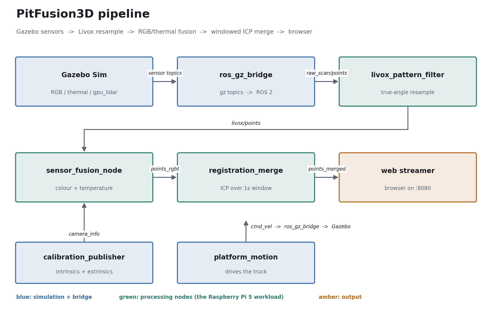
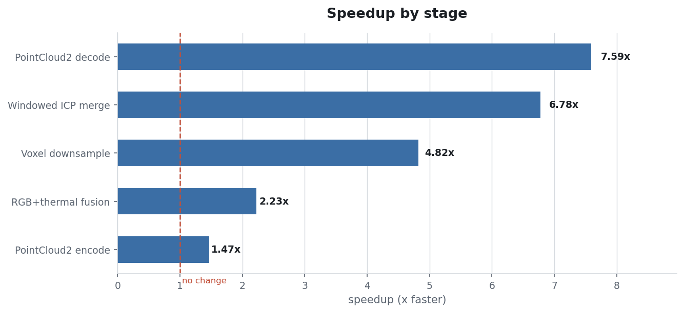
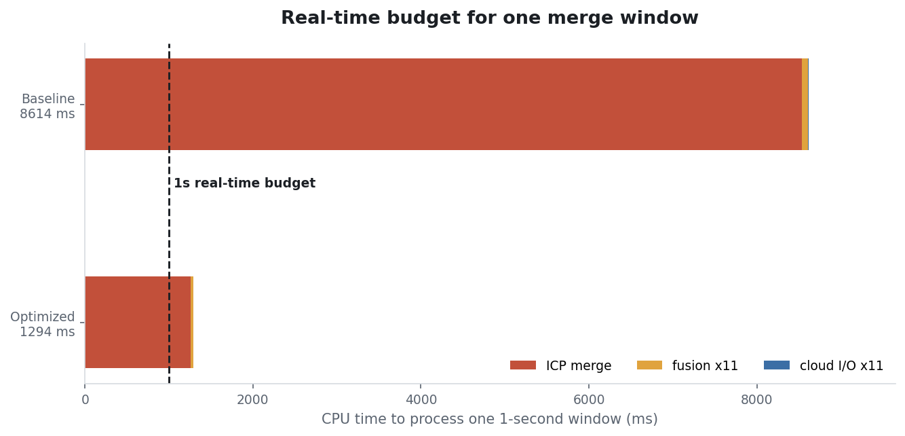

# PitFusion3D

A ROS 2 (Jazzy) + Gazebo simulation of a multi-sensor landfill survey rig --
RGB camera, thermal camera, and Livox Avia lidar -- with a calibration layer
and a fusion pipeline that colorizes the lidar cloud with camera colour and
per-point temperature, then merges it into a denser, motion-compensated cloud
you can open in a browser.



The green nodes are the deployment workload: on real hardware they run on a
Raspberry Pi 5 against physical sensors, with Gazebo replaced by the real
RGB/thermal cameras and a Livox Avia. Everything in blue exists so the
pipeline can be developed and tested without the rig.

## Quick start

```bash
# from the workspace root
colcon build --symlink-install
source install/setup.bash

# scenario (headless is much faster without GPU-accelerated rendering)
ros2 launch landfill_camera_sim landfill_camera_sim.launch.py rviz:=false gz_gui:=false

# fusion pipeline, run alongside whichever scenario is up
ros2 launch landfill_camera_sim sensor_fusion.launch.py

# browser view of the merged cloud at http://localhost:8080/
ros2 launch landfill_camera_sim web_stream.launch.py
```

Requires ROS 2 Jazzy, Gazebo (`gz-sim`) via `ros_gz_sim`/`ros_gz_bridge`, and
Python's `numpy`, `scipy`, and `cv_bridge` (all standard with a
`ros-jazzy-desktop` install).

## Real hardware deployment

[`src/pitfusion3d_bringup`](src/pitfusion3d_bringup) replaces the Gazebo
scenario above with the actual rig -- Livox Avia, Raspberry Pi camera,
UVC thermal camera -- feeding the same `sensor_fusion.launch.py` /
`web_stream.launch.py` unmodified:

```bash
ros2 launch pitfusion3d_bringup pitfusion3d_full.launch.py
```

Also includes a standalone-WiFi-hotspot mode for viewing the fused cloud
from a laptop with no router or existing network involved. See that
package's README for the deployment notes and hardware/networking issues
resolved along the way (NIC troubleshooting, ROS2 discovery vs. a
changing WiFi subnet, running the viewer with zero internet dependency).

## The sensor truck

The platform is a works truck: cab, open refuse body, tandem rear axles, and a
mast carrying the co-located RGB / thermal / lidar pod. It drives along its own
forward axis through the landfill scene while the pipeline runs.


The world models a working landfill with a thermal signature that is actually
worth imaging: a gas flare at 760 K, smouldering subsurface hot spots at
370-425 K on the active cell, sun-warmed asphalt and scrap metal in the 310-325 K
band, a capped cell under vegetation near ambient, and a leachate pond at 291 K.

## Livox scan pattern: correctness fix

The Avia is a Risley-prism scanner -- two rotating prisms sweep a
non-repetitive rosette across a 70.4 x 77.2 deg field of view. Gazebo's
`gpu_lidar` only offers a uniform grid, so the resampler previously picked the
nearest grid cell for each pattern ray and copied that cell's XYZ. Every return
therefore snapped to one of just 120 elevations, and a 24 000-point scan landed
on only 12 304 distinct cells -- visible banding that reads like a multi-beam 2D
scanner rather than a Livox.


The grid is now treated purely as a *range source*: each pattern ray keeps its
own exact azimuth/zenith, bilinearly samples a range out of the range image, and
the point is rebuilt along its true direction. Depth discontinuities fall back
to nearest-neighbour so edges stay sharp instead of generating flying pixels.

The effect is measurable end to end -- from the same ~206 000 raw points per
window, the merged cloud went from ~67 000 to ~163 000 points, because returns
no longer collapse onto duplicate grid cells.

## Performance

The processing nodes were rewritten for the Pi 5 target. Measured with
`benchmark/bench_offline.py`, which runs on synthetic data with no simulator
involved, so the numbers reflect CPU cost of the pipeline code rather than
whatever real-time factor Gazebo happens to hit.



| stage | baseline | optimized | speedup |
|---|---:|---:|---:|
| PointCloud2 decode (24k pts, 32B stride) | 0.03 ms | 0.00 ms | **7.6x** |
| PointCloud2 encode (24k pts, 6 fields) | 0.15 ms | 0.10 ms | **1.5x** |
| Voxel downsample (264k pts, 1 cm) | 308.8 ms | 64.0 ms | **4.8x** |
| RGB+thermal fusion (24k pts, 1280x720) | 6.70 ms | 3.01 ms | **2.2x** |
| Windowed ICP merge (11 scans x 24k pts) | 8538 ms | 1259 ms | **6.8x** |
| **Total** | **8854 ms** | **1326 ms** | **6.7x** |



Processing one second of sensor data went from ~8.6 s of CPU (8.6x slower than
real time) to ~1.3 s. The full write-up, including what was slow and why, is in
**[the optimization report (PDF)](src/landfill_camera_sim/benchmark/report/optimization_report.pdf)**.

### What changed

- **Cloud I/O** -- `sensor_msgs_py` rebuilt an intermediate structured array per
  message. Now `msg.data` is mapped with a numpy dtype carrying the real field
  offsets, and the x/y/z/intensity block is taken as one strided view.
- **Voxel downsample** -- `np.unique(keys, axis=0)` lexsorts an (N,3) array. The
  three integer voxel coordinates are now hashed into one int64 key so the
  dedupe is a 1-D sort. Selection is bit-identical.
- **Fusion** -- the whole 1280x720 thermal frame was converted to Kelvin
  (921k pixels) when only ~24k points sample it. Now the raw `uint16` is gathered
  at the projected pixels and only those values are converted; everything stays
  in float32; the extrinsic hops are folded into one `(M, b)` at startup; and a
  co-located rig reuses the RGB projection for thermal.
- **ICP merge** -- each scan rebuilt a KD-tree over an ever-growing raw map. The
  running map is now kept voxel-downsampled and grown incrementally, source and
  target sizes are capped, and `distance_upper_bound` lets the tree prune.
  Correspondence search runs serial below 20k points because scipy's per-call
  thread spawn cost exceeded the parallel gain -- that alone was 2.1 s of a
  2.4 s window.

### Robustness fixes found along the way

Restarting Gazebo rewinds sim time, which silently wedged two nodes: the merge
node's window never closed again, and `ApproximateTimeSynchronizer` kept matching
against messages stamped in the future. Both now detect the rewind and reset.

## Benchmarking

```bash
# offline, per-stage, baseline vs optimized (no simulator needed)
python3 src/landfill_camera_sim/benchmark/bench_offline.py --repeat 15

# regenerate the PDF report and figures
python3 src/landfill_camera_sim/benchmark/make_report.py
python3 src/landfill_camera_sim/benchmark/make_diagrams.py

# live end-to-end rates against a running pipeline
python3 src/landfill_camera_sim/benchmark/bench_live.py --duration 90
```

The pre-optimization implementations are preserved verbatim under
`benchmark/baseline/` so the comparison stays honest.

Live rates on this WSL2 desktop (Gazebo at ~0.5 real-time factor, so the
simulator is the bottleneck, not the pipeline):

| topic | rate | points/msg |
|---|---:|---:|
| `livox/points` | 4.31 Hz | 18 384 |
| `fusion/points_rgbt` | 4.31 Hz | 18 384 |
| `fusion/points_merged` | ~0.45 Hz | ~163 000 |

Fusion keeps up 1:1 with its input. The merged-cloud rate is taken from the
node's own log: at ~4 MB per message an extra benchmark subscriber drops most of
them over default DDS, so the externally observed rate understates it.

## Sensor profiles

Two interchangeable configs:

- `config/sensors_sim.yaml` -- full fidelity: 1280x720 RGB + thermal at 30 Hz,
  200x120 lidar grid, 24 000 points/scan.
- `config/sensors_sim_lite.yaml` -- quarter-resolution images, quarter the lidar
  rays, half rate. For constrained hardware or faster iteration.

```bash
ros2 launch landfill_camera_sim landfill_camera_sim.launch.py \
  config_file:=$(ros2 pkg prefix landfill_camera_sim)/share/landfill_camera_sim/config/sensors_sim_lite.yaml
```

## Layout

```
src/landfill_camera_sim/
  config/       sensor profiles, calibration, Livox Avia scan table
  launch/       scenario, fusion, and web-stream launches
  scripts/      pipeline nodes + shared cloud_io helpers
  worlds/       SDF templates (landfill scene, truck, thermal sources)
  benchmark/    offline + live benchmarks, report and figure generators
```

See [`src/landfill_camera_sim/README.md`](src/landfill_camera_sim/README.md)
for the scenarios, calibration files, and node-by-node detail.
