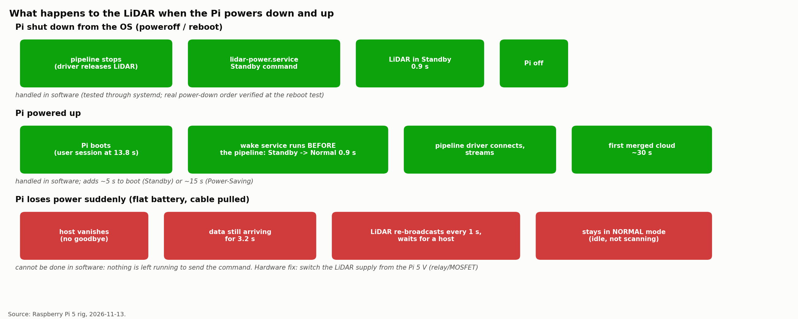
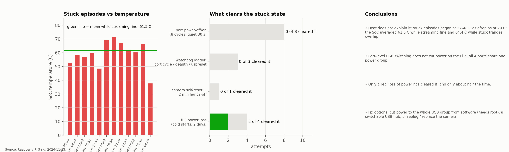
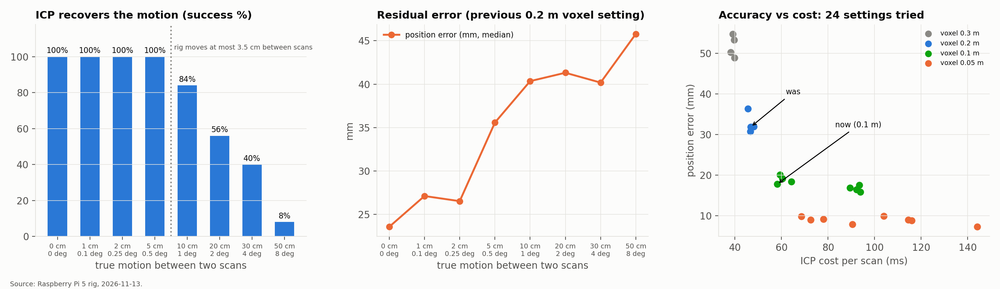
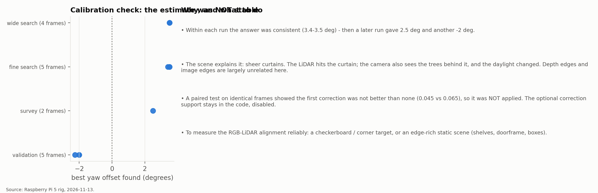
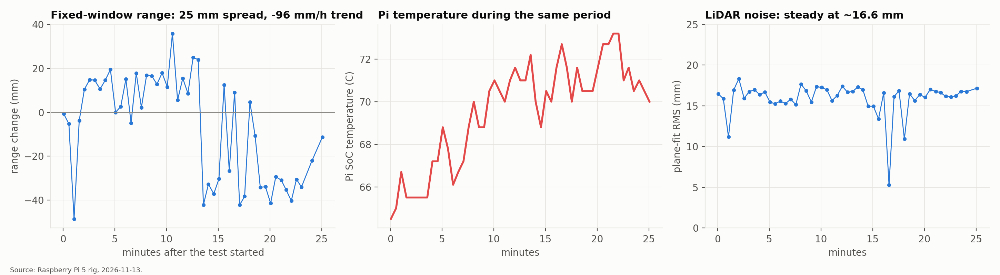
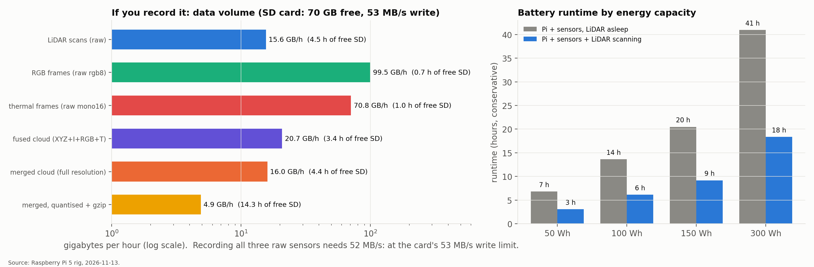
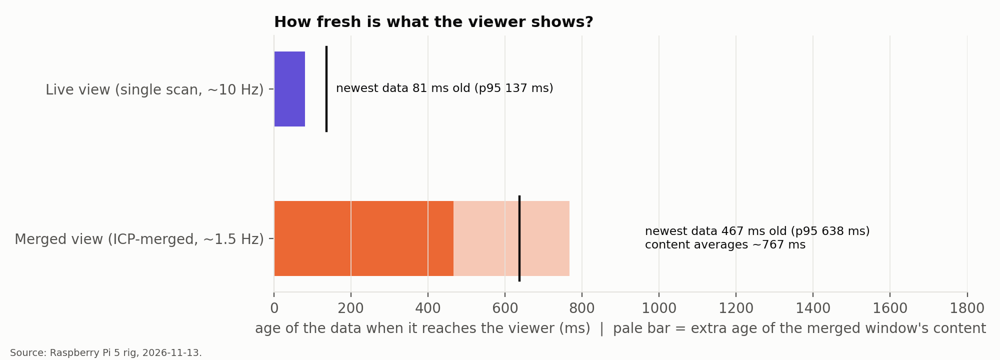
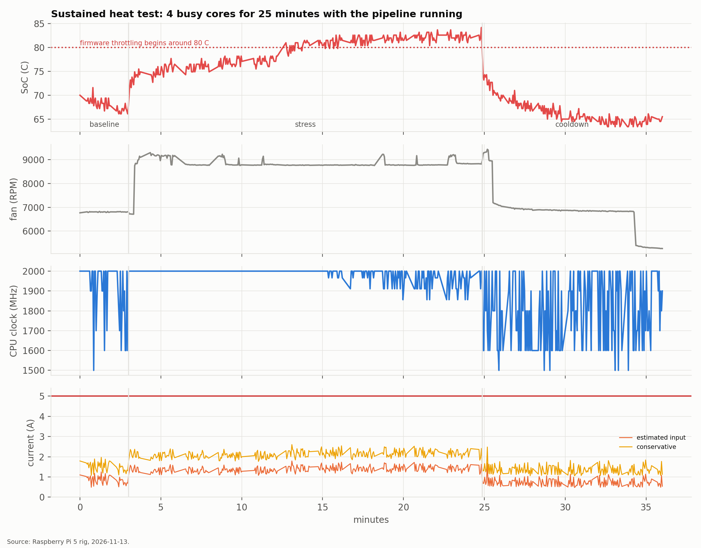
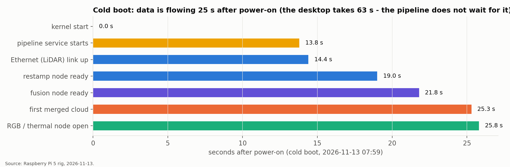
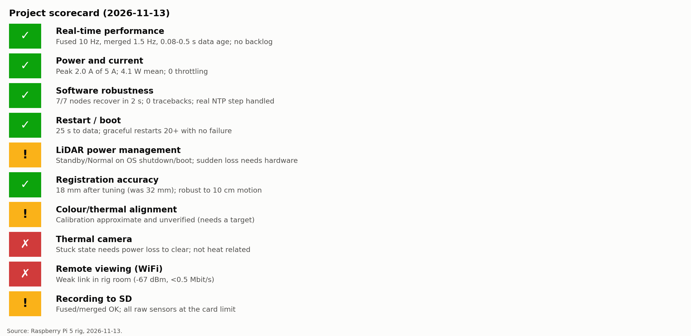

# Day-2 figures: captions

## D01_lidar_power_paths - LiDAR behaviour on power-down and power-up

**Suggested caption:** The three ways the Pi can lose or gain power and what the LiDAR does in each. Green = handled automatically by the installed service. Red = physically impossible to handle from the Pi; measured on the real unit with the controlling process killed without warning.

## D02_thermal_camera_investigation - Thermal camera: heat theory and recovery experiments

**Suggested caption:** Left: SoC temperature at the start of each of the 12 stuck episodes against the average while the camera streams fine. Middle: every recovery method tried and how many attempts cleared the stuck state. Right: what follows from the evidence.

## D03_icp_accuracy - Registration (ICP) accuracy with known ground truth

**Suggested caption:** A real merged cloud was moved by known amounts and the production ICP had to recover the motion. Left: success rate. Middle: residual error with the previous 0.2 m voxel (the 0.1 m now in production roughly halves it). Right: the accuracy/cost trade-off of 24 parameter combinations; the 0.1 m voxel now in production halves the error for about 11 ms more per scan.

## D04_calibration_check - RGB-LiDAR calibration check: inconclusive on this scene

**Suggested caption:** Estimated LiDAR-to-camera yaw error from edge alignment across four runs. The estimate jumped between runs because the scene (sheer curtains with daylight behind) is unsuitable; an honest negative result that defines what a proper calibration needs.

## D05_lidar_stability - LiDAR range stability over 25 minutes

**Suggested caption:** A fixed 6x6 degree window straight ahead and the dominant plane were tracked every 30 s. Noise (plane RMS) did not change as the sensor warmed. The measured range drifted about 3-4 cm shorter over 25 minutes (consistent with warm-up drift, though scene motion cannot be excluded). One sample with a person in the window was excluded.

## D06_data_and_battery_planning - Data volume and battery runtime

**Suggested caption:** Left: gigabytes per hour of each stream, and how long the free SD space lasts. Right: runtime for typical battery capacities, using the measured Pi power (conservative bound 7.3 W) plus the manufacturer's typical 9 W for the LiDAR (not measured here).

## D07_data_freshness - End-to-end data freshness

**Suggested caption:** Age of the newest data in each payload when the client receives it, measured with the streamer's own timestamp header (X-Cloud-Stamp / X-Server-Time). The live view is about 0.08 s old; the merged view is about 0.47 s old and summarises a 0.6 s window, so its content averages about 0.8 s.

## D08_heat_endurance - Sustained-heat test

**Suggested caption:** SoC temperature, fan speed, CPU clock and input current through a baseline, 25 minutes of all four cores at 100 % (with the pipeline running) and a cool-down. Shows the thermal headroom of the system in this room and how the fan and clock respond.

## D09_cold_boot_timeline - Cold-boot timeline

**Suggested caption:** Time from power-on to each pipeline stage, from the kernel journal's monotonic clock (immune to the Pi's stale clock). The installed LiDAR wake step runs before the pipeline and adds about 5 s from Standby.

## D10_scorecard - Project scorecard

**Suggested caption:** One-page status by area. Green = meets the goal, amber = works with a stated limitation, red = needs action. Symbols are repeated beside the colours so the chart reads in greyscale.
