# Thesis figures: captions and notes

Every figure exists as a 200 dpi PNG and a vector PDF in this folder. Colour identifies the stream in every figure: LiDAR blue, RGB green, thermal red, fused violet, merged orange, viewer yellow. Source data is in `../data/`; regenerate with `python3 make_thesis_figures.py`.

## F01_architecture - System architecture

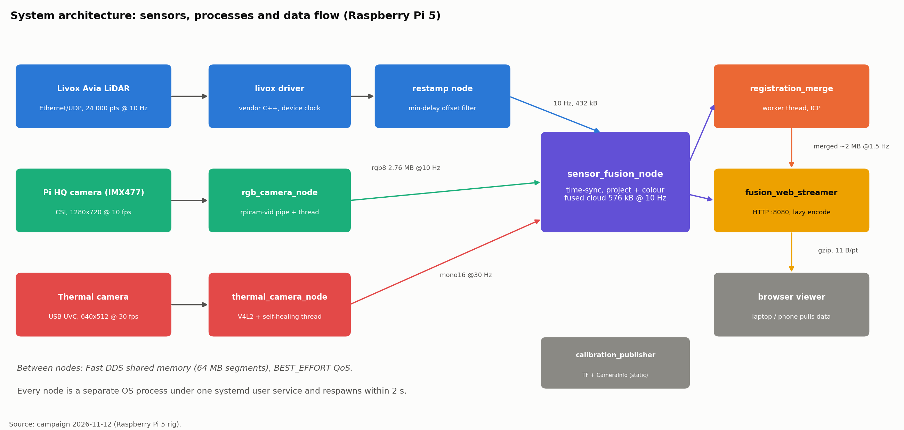

**Suggested caption:** Block diagram of the whole system. Colour identifies the data stream (LiDAR blue, RGB green, thermal red, fused violet, merged orange, viewer yellow) and is used for the same streams in every other figure. Use as the overview figure of the methods chapter.

## F02_process_cost - CPU, memory and threads per process

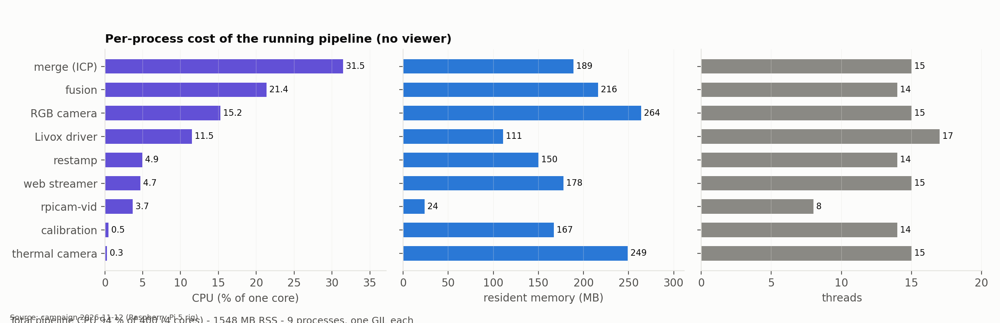

**Suggested caption:** Steady-state cost of each pipeline process with no viewer connected. Merge (ICP) and fusion dominate; every node is its own process, so no Python GIL is shared between nodes.

## F03_latency_by_stage - Latency by stage

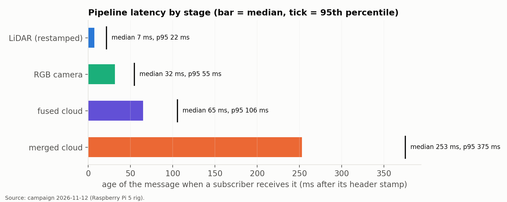

**Suggested caption:** Age of each message at the moment it reaches a subscriber, measured against its own header stamp. The merged cloud is the oldest because it deliberately contains the scans of a 0.5-0.6 s window and carries the last scan's stamp.

## F04_wire_format - Viewer wire format

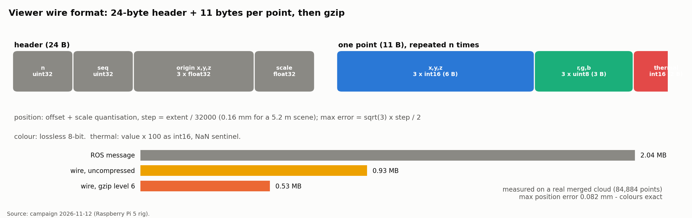

**Suggested caption:** Byte layout of the data served to the browser, with the size reduction measured on a real merged cloud and the measured quantisation error. The format adds about 0.14 mm of position error, far below the LiDAR's own noise.

## F05_power_timeline - Power timeline

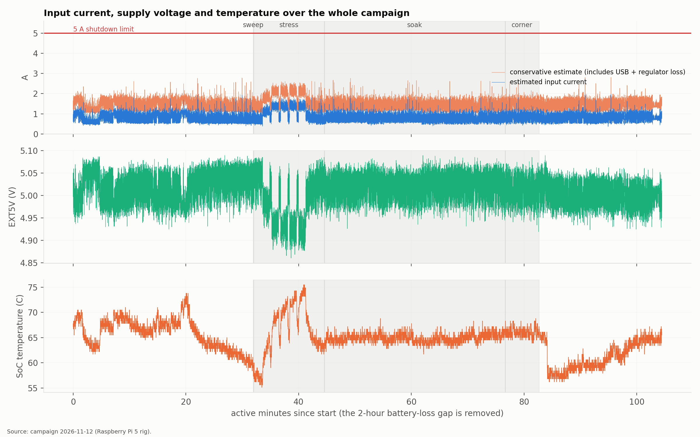

**Suggested caption:** Estimated input current (blue), a conservative bound (orange) and the 5 A shutdown limit (red) over 1 h 45 min of testing, with supply voltage and SoC temperature below. Shaded bands mark the stress ramp, sweep, soak and corner-case phases.

## F06_current_headroom - Current distribution and headroom

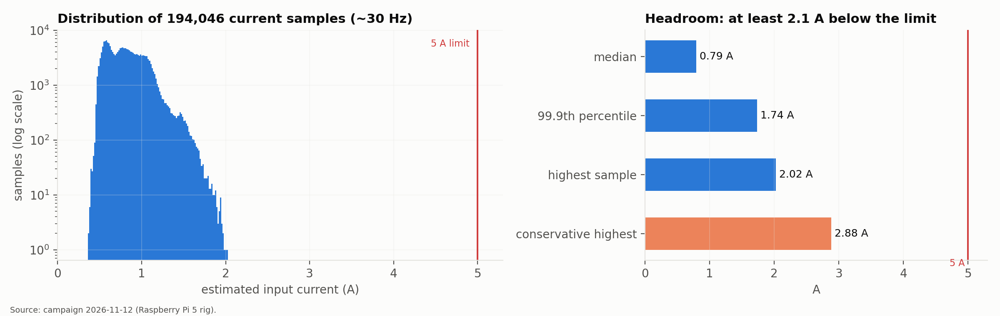

**Suggested caption:** Left: distribution of every current sample. Right: the typical and extreme values against the 5 A limit. Sampling is about 30 ms, so spikes shorter than that cannot be seen; the conservative estimate bounds the unmetered USB and regulator losses.

## F07_stress_ramp - CPU stress ramp

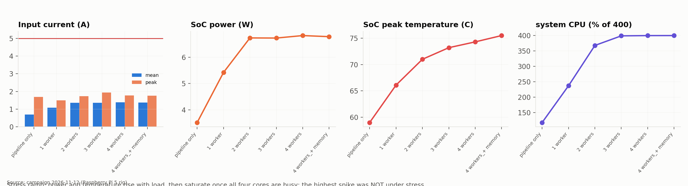

**Suggested caption:** Pipeline running while 0 to 4 busy workers (plus memory traffic) were added. Mean current and power plateau at two workers because the CPU is capped at 2.0 GHz and the cores are already saturated; the highest single current spike of the campaign occurred at idle, so spikes are not caused by sustained load.

## F08_pointcap_tradeoff - Point-cap trade-off

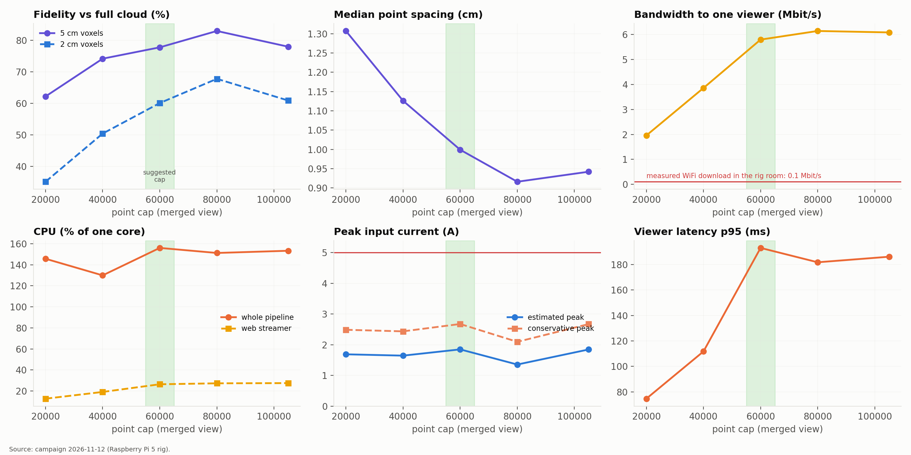

**Suggested caption:** Effect of the number of points served per merged cloud on fidelity, bandwidth, CPU, peak current and latency (green band = suggested 60 000-point cap). Quality improves steadily while bandwidth and CPU rise; input current does not depend on the cap at all. Above about 70 000 the merged cloud itself contains no more points than the cap, so the 80 000 and 105 000 settings serve nearly the same cloud. The measured WiFi download speed in the rig room (red line) shows the radio, not the Pi, is the practical limit.

## F09_live_view_sweep - Live-view sweep

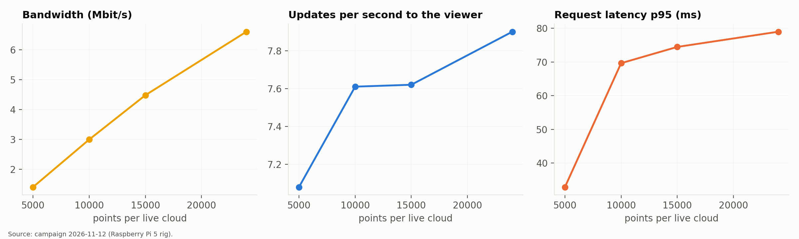

**Suggested caption:** The live (single-scan, ~10 Hz) view for caps of 5 000 to 25 000 points: bandwidth grows roughly linearly while the update rate rises to about 8 per second.

## F10_rates_and_jitter - Rates and jitter

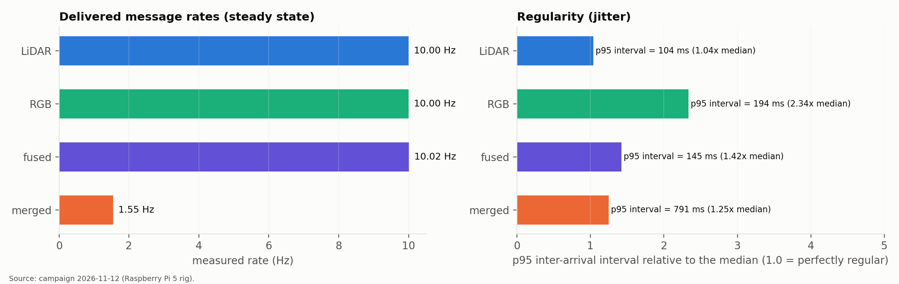

**Suggested caption:** Left: delivered rate of each stream. Right: how irregular the arrivals are (95th-percentile interval relative to the median). The RGB stream is the most irregular because frames are stamped in bursts after a variable decode delay.

## F11_robustness_matrix - Robustness matrix

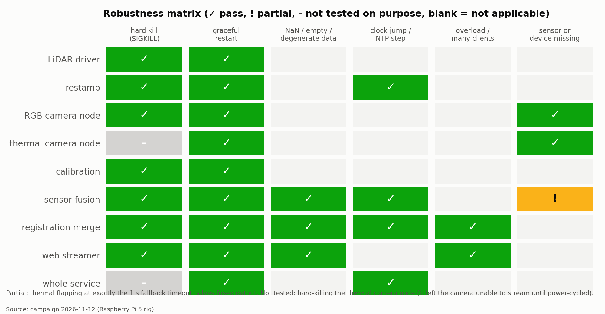

**Suggested caption:** Which failure classes were exercised against which component, from the corner-case suites, the SIGKILL/respawn test, the restart tests and a real NTP clock step. Status colours are always paired with a symbol.

## F12_thermal_camera_history - Thermal camera reliability

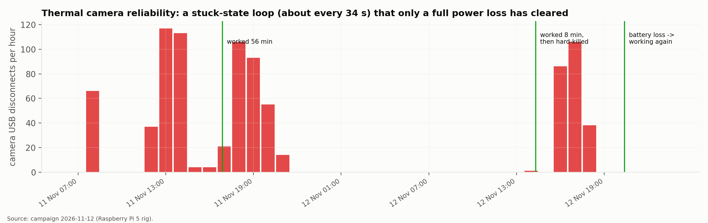

**Suggested caption:** USB disconnects per hour for the thermal camera. Each high bar is the stuck state: the camera enumerates, never sends frames and resets about every 34 s. Green lines mark the times it streamed correctly, each time after a full power loss. The watchdog added on 12 Nov detects the state and will auto-recover once the one-time permission step is done.

## F13_before_after - Before and after the performance work

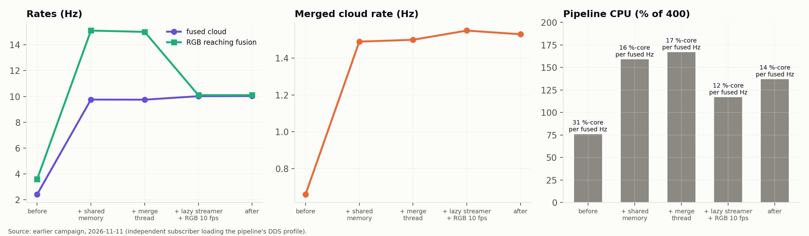

**Suggested caption:** The staged improvements of the 2026-11-11 performance work (values from docs/performance_2026-11-11). Fused output rose 4x and merged 2.3x; CPU per delivered fused Hz fell from 31 to about 13 %-core.

## F14_pointcloud_gallery - Point cloud gallery

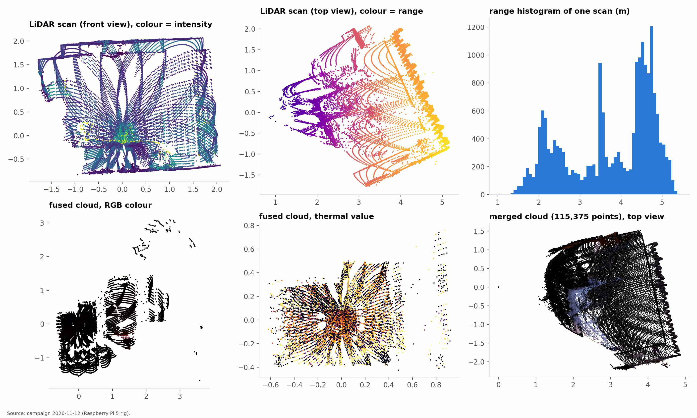

**Suggested caption:** One real LiDAR scan, the same scan after RGB and thermal colouring, and the ICP-merged cloud. Use these as the visual results figure.

## F15_startup - Start-up timeline

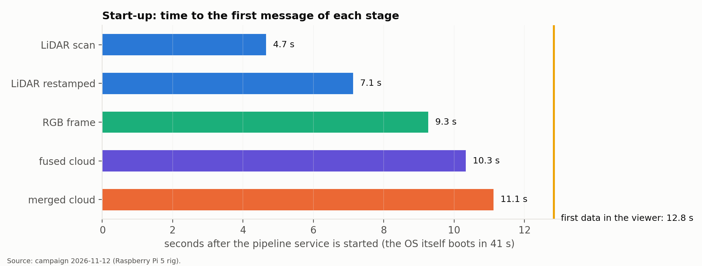

**Suggested caption:** Time from starting the pipeline service to the first message at each stage, measured with a subscriber waiting beforehand. The viewer shows data about 13 s after the service starts; a graceful restart takes the same time.

## F16_real_ntp_step - Real clock step

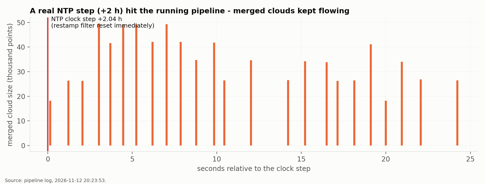

**Suggested caption:** Each orange bar is one merged cloud published around the moment NTP stepped the Pi's clock forward by about two hours, 36 s after boot. The new step detector reset the LiDAR offset filter at once; with the previous code fusion would have produced nothing for about 20 s.

## F17_key_results_dashboard - Key results dashboard

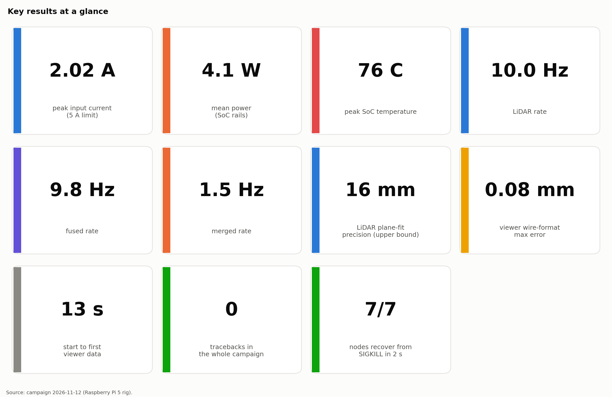

**Suggested caption:** A summary panel of the headline numbers, each tile coloured by the entity it describes. Suitable as a results-overview infographic.

## F18_battery_runout - Battery run-out

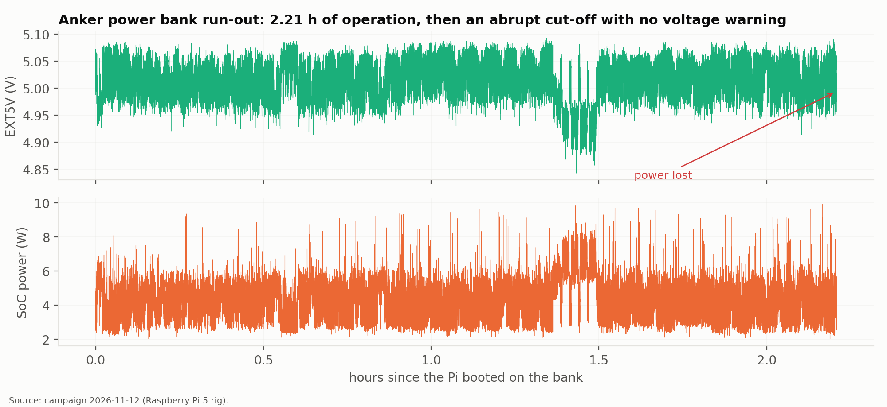

**Suggested caption:** Supply voltage and SoC power for the whole session on the power bank. The voltage stays flat at about 5.0 V until the bank cuts out, so software cannot predict the shutdown from the supply voltage; plan runtime from the energy figure instead.

## F19_network_and_viewer_scaling - Network and viewer scaling

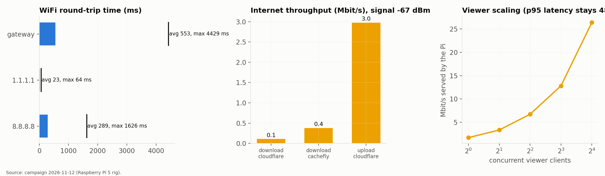

**Suggested caption:** Left and middle: the WiFi link in the rig room (weak signal, long round-trip times, under 0.5 Mbit/s download). Right: the Pi itself serves 16 concurrent clients with flat latency, so the radio, not the Pi, limits what a remote viewer sees.

## F20_sensor_characterisation - Sensor characterisation

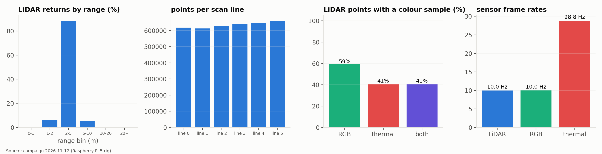

**Suggested caption:** LiDAR range and line distribution, how many LiDAR points fall inside each camera image (field-of-view overlap, not colour accuracy) and the sensors' delivered frame rates.
