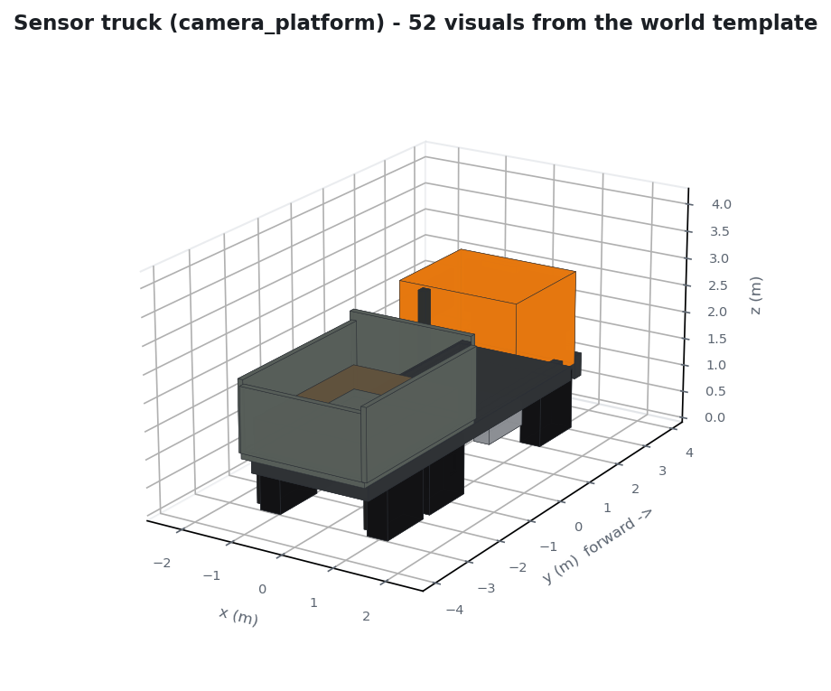
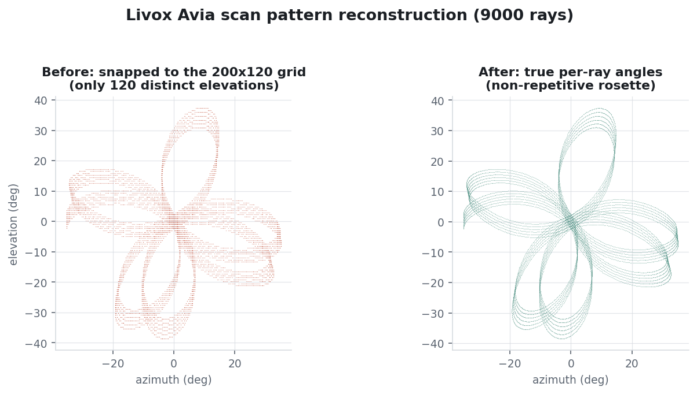
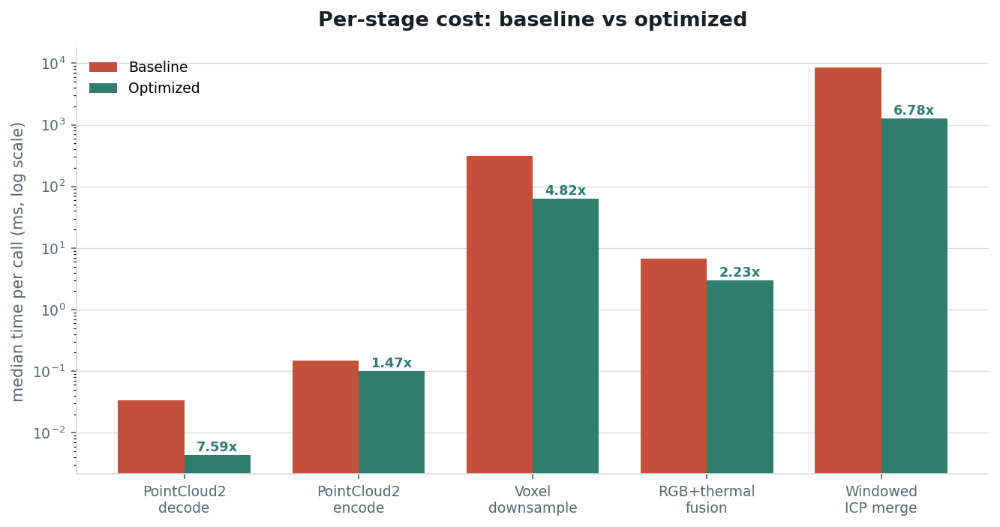

# Landfill Camera Simulation

Gazebo + ROS 2 simulation of a sensor rig -- an RGB camera, a thermal
camera, and a Livox Avia-style lidar, all co-located in one enclosure --
plus a calibration layer and a fusion pipeline that colorizes the lidar
cloud with the camera data and merges it into a denser, motion-compensated
map.

## Scenarios

Two interchangeable worlds, both using the exact same sensor rig, config
schema, and node stack:

- **`landfill_camera_sim.launch.py`** (`config/sensors_sim.yaml`,
  `worlds/landfill_camera_world.sdf.in`) -- the rig rides a mast on a works
  truck (cab, open refuse body, tandem rear axles) that drives back and forth
  along a landfill access road.
- **`scan_test_sim.launch.py`** (`config/scan_test_sim.yaml`,
  `worlds/scan_test_world.sdf.in`) -- the rig is stationary and slowly
  yaws in place (no translation) inside a ring of ~24 colorful primitive
  shapes (boxes, spheres, cylinders), for a clean 360-degree scan test.

```bash
ros2 launch landfill_camera_sim landfill_camera_sim.launch.py
ros2 launch landfill_camera_sim scan_test_sim.launch.py
```

Server-only (no GUI):

```bash
ros2 launch landfill_camera_sim landfill_camera_sim.launch.py gz_gui:=false rviz:=false
```

Each scenario is entirely self-contained -- run whichever one you want,
independently of the other:

| | Landfill (moving platform) | Scan test (stationary, rotating) |
|---|---|---|
| Simulator | `ros2 launch landfill_camera_sim landfill_camera_sim.launch.py` | `ros2 launch landfill_camera_sim scan_test_sim.launch.py` |
| Fusion pipeline | `ros2 launch landfill_camera_sim sensor_fusion.launch.py` | `ros2 launch landfill_camera_sim sensor_fusion.launch.py lidar_points_topic:=/scan_test/livox/points rgb_image_topic:=/scan_test/rgb/image_raw thermal_image_topic:=/scan_test/thermal/image_raw fused_points_topic:=/scan_test/fusion/points_rgbt merged_points_topic:=/scan_test/fusion/points_merged` |
| Web streamer | `ros2 launch landfill_camera_sim web_stream.launch.py` | `ros2 launch landfill_camera_sim web_stream.launch.py input_topic:=/scan_test/fusion/points_merged` |



The landfill world carries a thermal signature worth imaging: a gas flare at
760 K, smouldering subsurface hot spots at 370-425 K on the active cell,
sun-warmed asphalt and scrap metal at 310-325 K, a capped cell under vegetation
near ambient, and a leachate pond at 291 K. Per-visual temperatures are set with
the `gz::sim::systems::Thermal` plugin so the thermal camera sees real contrast
instead of a uniform ambient field.

Around that sit the rest of the site: a weighbridge, site cabin, shipping
container, lighting masts, jersey barriers, perimeter fencing, skip bins, drums,
pallets, rebar and cones, plus a parked dozer.

### Moving vehicles

`scene_traffic_controller.py` drives three background vehicles -- a haul truck,
a wheel loader and a service pickup -- around looping routes so the scans are
not of a completely static scene.

They are kinematic models carrying gz-sim's `VelocityControl` plugin, driven by
ROS `Twist` through the same bridge the sensor truck uses. Two other approaches
were tried and rejected:

- **`TrajectoryFollower`** applies a constant force, and with only Coulomb
  friction opposing it there is no terminal velocity, so the props accelerated
  past their waypoints and left the site.
- **Skinless `<actor>` trajectories** segfault gz-sim 8's `SceneBroadcaster`.

Note the routes are dead-reckoned from the commanded velocity (`VelocityControl`
publishes no odometry back), so each vehicle's `spawn yaw` in `DEFAULT_ROUTES`
must match its `<pose>` in the world template or it will veer off route.

Only the vehicles and the ground carry collision geometry. Decorative props are
visual-only on purpose: gz-sim's `gpu_lidar` and cameras raycast against
*rendered visuals*, not collisions, so the sensors still see them while the
physics engine ignores them entirely.

Sensor settings and topic names live in the YAML files under `config/`.
`config/sensors_sim_lite.yaml` is a reduced-cost profile (quarter-resolution
images, quarter the lidar rays, half rate) for constrained hardware or faster
iteration:

```bash
ros2 launch landfill_camera_sim landfill_camera_sim.launch.py \
  config_file:=$(ros2 pkg prefix landfill_camera_sim)/share/landfill_camera_sim/config/sensors_sim_lite.yaml
```

Platform motion is under `platform.motion` in each -- linear speed +
travel distance for the landfill run, `travel_distance: 0` with a nonzero
`angular_speed` for the stationary scan (see `platform_motion_controller.py`).

RViz opens by default (`rviz:=true`) showing the RGB image, thermal image,
and lidar point cloud together (`rviz/landfill_camera.rviz.in`).

## Lidar scan pattern

`livox_pattern_filter.py` resamples the native Gazebo `gpu_lidar` scan into
the real, non-repetitive Avia scan pattern from
[Livox-SDK/livox_laser_simulation](https://github.com/Livox-SDK/livox_laser_simulation)
(`config/scan_patterns/avia.csv`), rather than a synthetic curve -- see
`config/scan_patterns/README.md`.

Its input is the sensor's `<topic>/points` (`gz.msgs.PointCloudPacked`,
bridged to `sensor_msgs/msg/PointCloud2`) -- the real per-ray x,y,z grid
gz-sim's `gpu_lidar` publishes alongside its `LaserScan`, not the
`LaserScan` itself, which only carries one flat horizontal row with no
elevation information and can't represent a multi-row sensor like this
one. The `LaserScan` topic is still bridged (some tools expect it) but
isn't consumed by anything in this package.



The uniform grid is used purely as a **range source**. Each row of the Avia
table keeps its own exact azimuth/zenith, bilinearly samples a range out of
the grid's range image at those angles, and the point is rebuilt along that
ray's true unit direction:

    x = cos(zenith) cos(azimuth)
    y = cos(zenith) sin(azimuth)
    z = -sin(zenith)

matching `LivoxPointsPlugin::convertDataToRotateInfo` (azimuth as-is, zenith
shifted by -90 deg). A direction's elevation is then exactly `-zenith` and its
azimuth exactly `azimuth`, independent of one another, which is what makes the
(azimuth, elevation) grid interpolation valid.

Snapping each ray to its nearest grid cell instead -- the previous behaviour --
quantised every return onto one of only `vertical_samples` (120) distinct
elevations, so a 24 000-point scan landed on just 12 304 unique cells. That
renders as horizontal banding indistinguishable from a multi-beam 2D scanner.
Where the four neighbouring cells straddle a depth discontinuity the node falls
back to nearest-neighbour rather than blending, so edges stay sharp instead of
producing flying pixels.

The 34 MB / 960 000-row Avia table is parsed once and cached as `.npy` under
`$ROS_HOME/landfill_camera_sim/`, so node startup after the first run is
immediate.

### Verification against upstream

The upstream plugin is ROS 1 / Gazebo Classic (catkin + `RayPlugin`), so it
cannot be dropped into ROS 2 + gz-sim and its geometry is reimplemented here
instead. `test/test_scan_pattern.py` pins that reimplementation to the upstream
reference -- the direction vectors are compared against the quaternion
`livox_points_plugin.cpp` builds (`ray.Euler(0, zenith, azimuth)` applied to the
unit x axis) and agree to 4.4e-16 over 50 000 rays:

```bash
python3 -m pytest test/test_scan_pattern.py -v
```

Worth noting: upstream's own source contains a commented-out block that indexes
returns into a uniform grid exactly the way this package used to, immediately
above the live code that instead does `point = range * axis` per ray. The fix
here restores what upstream settled on.

## Calibration

`config/calibration/extrinsics.yaml` and `intrinsics.yaml` are the
editable, plain-text calibration for the rig: the rigid transform from the
rig frame to each sensor, and the RGB/thermal pinhole camera matrices.
`calibration_publisher.py` loads them at launch, publishes the extrinsics
as tf2 static transforms, and republishes `camera_info` on the RGB/thermal
topics from the intrinsics file (replacing Gazebo's own camera_info, so
the file is the single source of truth). Edit either file and relaunch to
change calibration -- see `config/calibration/README.md`.

## Sensor fusion pipeline

`sensor_fusion.launch.py` runs alongside either scenario above:

```bash
ros2 launch landfill_camera_sim landfill_camera_sim.launch.py
ros2 launch landfill_camera_sim sensor_fusion.launch.py
```

- **`sensor_fusion_node.py`** time-synchronizes one lidar scan with the
  RGB and thermal images (`message_filters.ApproximateTimeSynchronizer`),
  projects each lidar point into both cameras using the calibration files,
  and republishes the cloud with two extra fields: a packed `rgb` color
  and a `thermal` temperature (Kelvin) sampled from the images
  (`/.../fusion/points_rgbt`). Points outside a camera's field of view
  keep their lidar geometry but get no color/thermal value.
- **`registration_merge_node.py`** buffers a rolling 1-second window of
  those colorized scans and merges them into one denser cloud, aligning
  each scan to the growing map with point-to-point ICP (SciPy `cKDTree` +
  SVD/Kabsch, implemented in-file -- no PCL/Open3D dependency) to
  compensate for platform motion between scans before merging
  (`/.../fusion/points_merged`).

Both are plain parameters (topics, sync slop, window duration, ICP voxel
size/iterations) -- see `sensor_fusion.launch.py` for the full list, and
override `*_topic` there when running against `scan_test_sim.launch.py`'s
`/scan_test/...` topics instead of the landfill scenario's `/landfill/...`.

## Streaming the fused cloud over the network

`web_stream.launch.py` serves the merged cloud to any browser -- no ROS
install needed on the viewing device:

```bash
ros2 launch landfill_camera_sim web_stream.launch.py
```

`fusion_web_streamer.py` subscribes to `points_merged` (override
`input_topic` for `points_rgbt` or a `/scan_test/...` topic), keeps the
latest scan as a compact binary buffer, and serves it plus a
self-contained three.js viewer (RGB/thermal color toggle, orbit camera)
over plain HTTP on port 8080 (`http_port` param) -- open
`http://<this-machine>:8080/`.

**Reaching it from another device on WiFi, from WSL2:** WSL2 puts this
machine behind a NAT (its own IP, e.g. `172.18.213.120`, isn't reachable
from the LAN), but Windows forwards `localhost` into WSL2 automatically,
so `http://localhost:8080/` already works *on the Windows host itself*.
For other devices on the WiFi network, forward the port from Windows to
WSL2 -- in an elevated PowerShell on the Windows host:

```powershell
netsh interface portproxy add v4tov4 listenaddress=0.0.0.0 listenport=8080 connectaddress=<WSL2-IP> connectport=8080
netsh advfirewall firewall add rule name="PitFusion3D web stream" dir=in action=allow protocol=TCP localport=8080
```

Get `<WSL2-IP>` from `ip addr show eth0` inside WSL2 (it can change on
reboot, so redo the `portproxy` line if it stops working after one).
Then browse to `http://<windows-wifi-ip>:8080/` from any device on the
network (find the Windows WiFi IP with `ipconfig`).

## Performance and benchmarking

The pipeline nodes target a Raspberry Pi 5 running against real sensors, so the
processing hot paths were rewritten for CPU cost. `benchmark/bench_offline.py`
compares them against the pre-optimization implementations, which are preserved
verbatim under `benchmark/baseline/`. It runs on synthetic data with no
simulator involved, so the numbers reflect the pipeline code rather than
whatever real-time factor Gazebo achieves.



| stage | baseline | optimized | speedup |
|---|---:|---:|---:|
| PointCloud2 decode (24k pts, 32B stride) | 0.03 ms | 0.00 ms | 7.6x |
| PointCloud2 encode (24k pts, 6 fields) | 0.15 ms | 0.10 ms | 1.5x |
| Voxel downsample (264k pts, 1 cm) | 308.8 ms | 64.0 ms | 4.8x |
| RGB+thermal fusion (24k pts, 1280x720) | 6.70 ms | 3.01 ms | 2.2x |
| Windowed ICP merge (11 scans x 24k pts) | 8538 ms | 1259 ms | 6.8x |
| **Total** | **8854 ms** | **1326 ms** | **6.7x** |

Processing one second of sensor data went from ~8.6 s of CPU to ~1.3 s. The full
write-up is in [`benchmark/report/optimization_report.pdf`](benchmark/report/optimization_report.pdf).

```bash
python3 benchmark/bench_offline.py --repeat 15   # per-stage, baseline vs optimized
python3 benchmark/make_report.py                 # PDF + figures
python3 benchmark/make_diagrams.py               # pipeline + platform figures
python3 benchmark/bench_live.py --duration 90    # live rates, needs a running pipeline
```

Key changes:

- **`cloud_io.py`** -- shared zero-copy PointCloud2 helpers. `msg.data` is mapped
  with a numpy dtype carrying the real field offsets, so padded layouts (gz-sim's
  32-byte stride) need no repacking, and consecutive float32 fields come back as
  one strided view.
- **`registration_merge_node.py`** -- the running map is kept voxel-downsampled
  and grown incrementally rather than rebuilding a KD-tree over an ever-growing
  raw map; ICP source/target sizes are capped; voxel keys are hashed to int64 so
  the dedupe is a 1-D sort instead of `np.unique(..., axis=0)`. Correspondence
  search stays serial below 20k points -- scipy's per-call thread spawn cost was
  2.1 s of a 2.4 s window.
- **`sensor_fusion_node.py`** -- samples the raw thermal `uint16` at the projected
  pixels and converts only those ~24k values instead of the whole 921k-pixel
  frame; stays in float32; folds the extrinsic hops into one `(M, b)` at startup;
  reuses the RGB projection for thermal when the rig is co-located.

Both the merge node and the fusion node now detect a backwards jump in message
timestamps (which happens whenever Gazebo restarts and sim time rewinds) and
reset their window / synchronizer queues instead of silently wedging.
